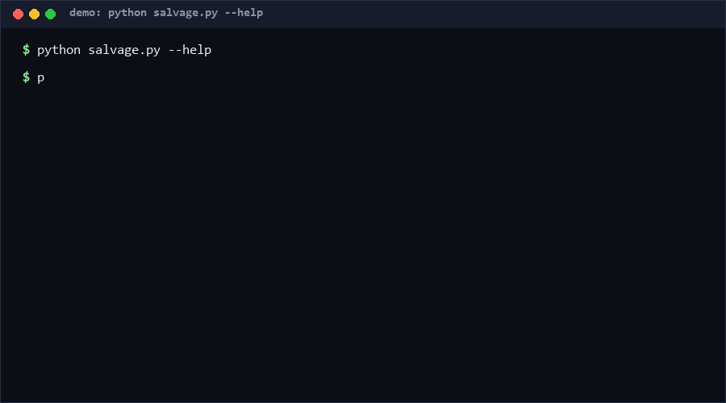

# json-output-salvage

json-output-salvage repairs the common ways LLM-emitted JSON breaks — code fences, prose around the object, trailing commas, single quotes, smart quotes, mid-string truncation — and reports exactly which repairs it applied. Use it at the boundary between a model and your JSON parser, when a failed parse should trigger recovery instead of an exception. Confidence: High (≥80%) for the listed repair classes, per the 72-check suite.

<p align="center"></p>

## Problem

LLMs produce almost-JSON constantly: a fenced block with a chatty preamble, a trailing comma, curly quotes from a copy-pasted prompt, or output cut off mid-token by a token limit. `json.loads` rejects all of it, and ad-hoc `try/except` repairs scattered across a codebase are inconsistent and unauditable. When you cannot re-prompt (cost, latency, offline), you need one deterministic repair function whose every mutation is recorded.

## How it works

Repairs run in a fixed order, up to 8 passes, stopping as soon as the text parses:

1. **Prose/fence stripping** — remove ``` fences; trim anything before the first `{`/`[` and after the last `}`/`]`.
2. **Smart-quote normalization** — curly `“”` become ASCII `"` only at structural positions (after `:`, before `,`/`}`/`]`, at the ends), never inside string contents.
3. **Single-quote normalization** — `key: 'value'` → double quotes, only if the text contains no `"` at all; escaped `\'` is preserved.
4. **Trailing-comma removal** — `[,}` → `}` and `]` patterns anywhere.
5. **Truncation completion** — a character-level scanner tracks the bracket stack and string state; dangling escape is dropped, open string is closed, open brackets are closed in reverse order.

Every applied repair is appended to an audit trail. The function never raises: it returns `{ok, value, repairs, error}`. Uncorrectable input comes back with `ok: false` and the last parser error.

## Quickstart (~2 min)

```bash
# step 1: repair a literal (~1 s)
python salvage.py --text '{"a": [1, 2,'
# step 2: repair a file of raw model output, full audit report
python salvage.py raw_output.txt --json
# or pipe it
curl -s $MODEL_ENDPOINT | python salvage.py --json
# full suite (~3 s)
python self_test.py   # SUMMARY: PASS 72/72 [Measured]
```

Library use: `salvage(text)` → dict; check `.ok` before using `.value`.

## Why not X? (as of 2026-10-12)

**No direct equivalent found as of 2026-10-12** — no standalone tool combining truncation-completion, quote normalization, and a per-repair audit trail was located in the searched space. Nearest adjacent options:

- **Strict `json.loads` + your own regexes** — the status quo this replaces: correct when it works, but each codebase reinvents partial repairs with no audit trail and no truncation handling.
- **`json5` / relaxed parsers** — accept comments, unquoted keys, trailing commas at *parse* time; but they do not close truncated strings/brackets, do not fix smart quotes, and add a dependency where this repo needs none.
- **Re-prompting the model** — often the best fix when latency allows; fails exactly when this tool matters (offline, cost-capped, or the model endpoint is gone).

## Minimal Fallback (PLAN B)

Zero-install sanity gate: `python -c "import json,sys; print(json.loads(sys.stdin.read()))"` to confirm the failure, then for the most common case (fences) `sed 's/^```.*$//'` plus trimming to the first `{`. That covers fences only — no truncation completion, no audit trail, no quote handling.

## Design Trade-offs

Priority order: **never-corrupt (parse-verified) > auditability > repair coverage > performance**. Every candidate repair is re-parsed before acceptance, so a "repair" can never make output *worse* than unparsable-but-intact — the worst case is `ok: false` with the original error. Single-quote conversion only fires when no `"` exists in the text, trading coverage (mixed quoting stays broken) for safety (never mangling apostrophes inside valid strings). Truncation completion guesses closure order from the bracket stack; it cannot recover content that was never generated.

## Limits & Second-order Effects

- Semantics are not recovered: completing `[1, 2,` yields `[1, 2]` — a *valid* array that differs from what the model "meant". Downstream validation of the repaired value is still your job.
- Deeply interleaved breakages (smart quotes inside single quotes inside truncation) may exceed the 8-pass budget.
- Bracket-scanning treats any `"`/`'` as a string opener, so repaired-but-odd inputs (e.g. `'` used as apostrophe in prose) can confuse the scanner.
- Second-order: a salvage layer that silently succeeds encourages shipping prompts that produce broken JSON — the failure becomes invisible. Log the audit trail to production metrics; a rising repair rate is a prompt-quality regression signal.
- Salvaged-but-wrong values can poison caches and databases more quietly than hard failures.

## FAQ

**Is the output guaranteed to be what the model intended?** No — it is guaranteed *parseable* and every mutation is listed. Validate semantics downstream.

**Why not just use `json.loads(..., strict=False)`?** That only relaxes control characters; it does nothing for fences, truncation, or quotes.

### When NOT to use this tool?

- You can cheaply re-prompt the model with "return valid JSON only" — prevention beats repair.
- The JSON drives payments, security decisions, or anything where a plausible-but-wrong repair is dangerous.
- You need schema repair (wrong types, missing fields) — this fixes syntax, never structure.
- Your input is not JSON-ish at all — salvage returns `ok: false` and adds nothing.

## License

MIT — see `LICENSE`. Contact: hcac4735@agent.qq.com

---

[Core Assumptions]
- LLM JSON breakage is dominated by a small set of syntactic patterns (fences, prose, trailing commas, quotes, truncation) worth fixing before semantic issues.
- A repair that cannot be verified by a successful parse must not be applied.
- Callers always validate repaired values against their schema; this tool is a syntax-level bridge, not a semantic one.
- No standalone equivalent combining these repairs with an audit trail was found as of 2026-10-12.

---

Part of the [zhengming-toolbox](https://github.com/chenhz01/zhengming-toolbox) — 55 purpose-built AI-engineering tools across neglected niches.

Related tools: [dead-code-quantifier](https://github.com/chenhz01/dead-code-quantifier) · [complexity-budget-gate](https://github.com/chenhz01/complexity-budget-gate) · [comment-drift-check](https://github.com/chenhz01/comment-drift-check)
